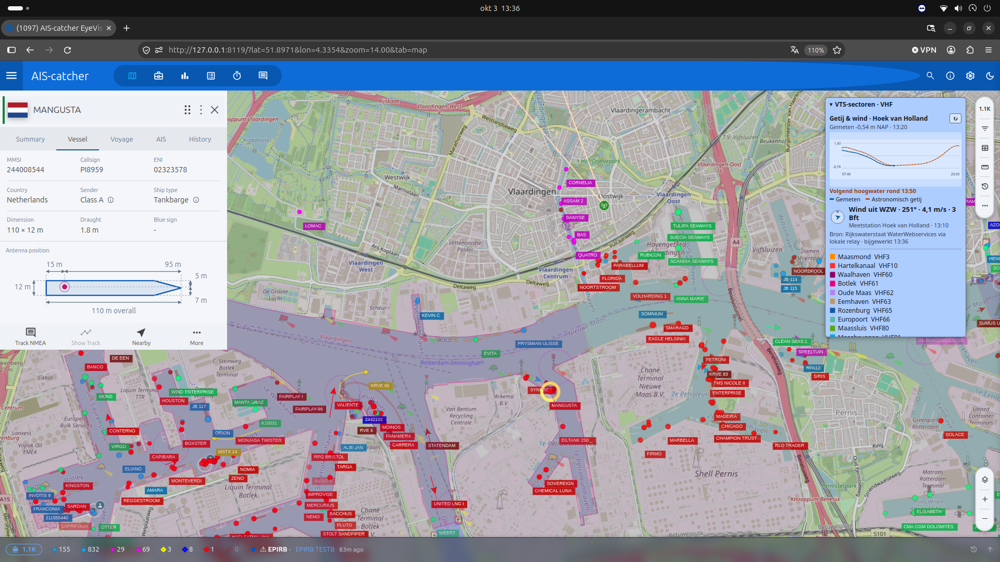

# AIS-Catcher Rijnmond VTS Sectors · v17.1

Plugin for the official Rijnmond VTS sectors, with current tide and wind data for Hoek van Holland.



## Features

- Official Rijkswaterstaat (RWS) sector polygons are stored locally in the plugin.
- The legend shows the measured water level and the astronomical tide forecast.
- The expected time of the next high tide appears below the chart.
- The legend also shows the current wind speed and direction at Hoek van Holland.
- A small local relay retrieves the RWS data. The relay is needed because the RWS web service does not provide the CORS headers required for browser requests.

The VTS legend starts collapsed and remembers its open or closed state for each browser and site address. It appears in the top-right corner, next to the AIS controls. The panel is light blue (`#adccff`), while the sector polygons retain their selected solid colors. If browser storage is unavailable, the legend still works, but its open or closed state is not remembered after a full page reload.

The sector polygons use official Rijkswaterstaat geometry and are sorted numerically by VHF channel: **3, 10, 60, 61, 62, 63, 65, 66, 80, and 81**. Oude Maas is purple (`#af85f2`), and Hartelkanaal uses the official RWS polygon.

The relay is restricted to the two RWS endpoints used by the plugin, the Hoek van Holland location, and the required water-level and wind observations. By default, it listens only on `127.0.0.1:8120`. The installer does not change firewall or router settings.

## Install or update

Clone the repository, or update an existing clone, then run the installer.

For a new installation:

```bash
git clone --branch main git@github.com:EyeVisionsNL/AIS-catcher-VTS-rijnmond-blok-layer.git
cd AIS-catcher-VTS-rijnmond-blok-layer
sudo ./install.sh
```

For an existing clone:

```bash
cd ~/AIS-catcher-VTS-rijnmond-blok-layer
git pull --ff-only origin main
sudo ./install.sh
```

If a plugin is already installed, the installer saves it once as `/etc/AIS-catcher/plugins/vts-sectoren.pjs.pre-v17.1`. It then installs the v17.1 plugin and relay, enables and starts the relay service, and restarts AIS-Catcher.

## Verify the installation

Check that the relay service is running:

```bash
sudo systemctl status ais-catcher-rws-relay.service --no-pager
```

Next, check the CORS preflight from AIS-Catcher to the local relay. The response should contain HTTP `204` and the required `Access-Control-Allow-*` headers:

```bash
curl -i --max-time 5 -X OPTIONS \
  'http://127.0.0.1:8120/ONLINEWAARNEMINGENSERVICES/OphalenLaatsteWaarnemingen' \
  -H 'Origin: http://127.0.0.1:8119' \
  -H 'Access-Control-Request-Method: POST' \
  -H 'Access-Control-Request-Headers: content-type'
```

Then hard-refresh the AIS-Catcher page with `Ctrl+F5` and open the VTS legend. Tide and wind data refresh while the legend is open.

To view the relay logs:

```bash
sudo journalctl -u ais-catcher-rws-relay.service -n 40 --no-pager
```

## Uninstall

Run this command from the repository directory:

```bash
sudo ./uninstall.sh
```

The uninstall script removes the relay service and restores the plugin that was installed before v17.1. If no backup exists, it removes the installed plugin only when the file is still the v17.1 release.

## VHF sector data

The geometry comes from the official RWS `vts-deelsector_v` layer (FeatureServer layer 67). The sector polygons remain available if RWS data is temporarily unreachable.

## License and attribution

Copyright (C) 2026 EyeVisionsNL. The project logo, branding, and original project-created graphics are EyeVisionsNL assets. The original software source code is licensed under GNU GPL-3.0-only; see [LICENSE](LICENSE).

Rijkswaterstaat sector data, live observations, and third-party software remain subject to their respective terms. See [THIRD_PARTY_NOTICES.md](THIRD_PARTY_NOTICES.md).
